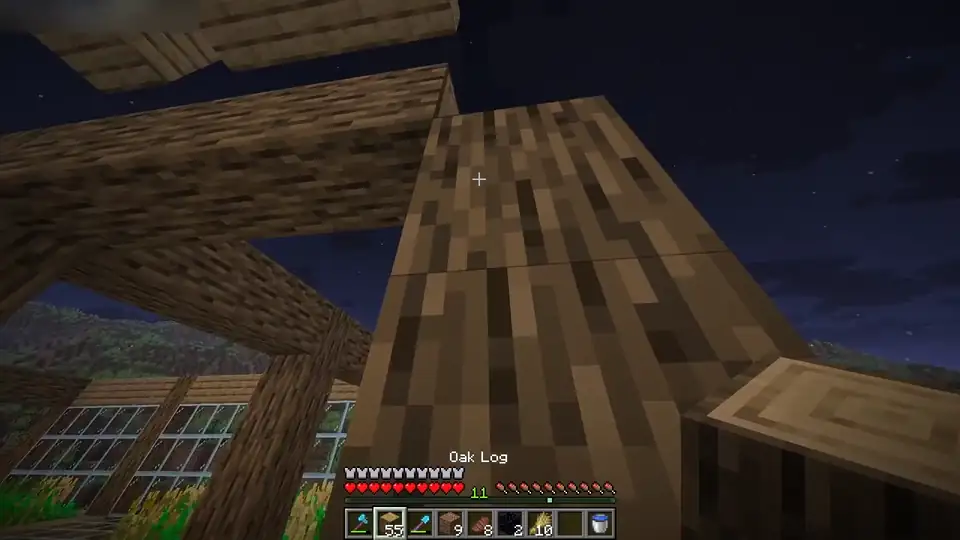
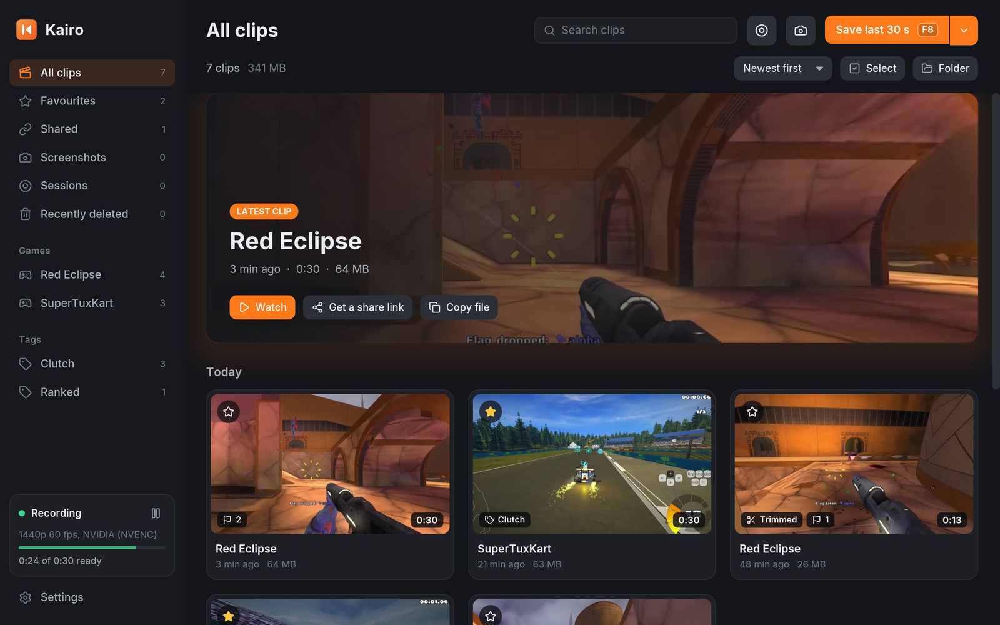
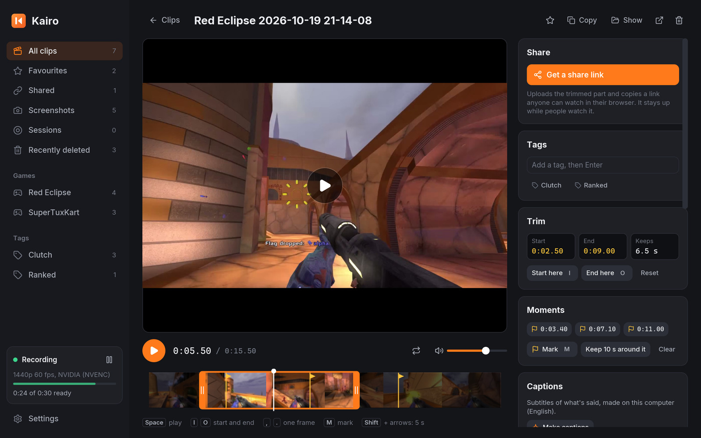
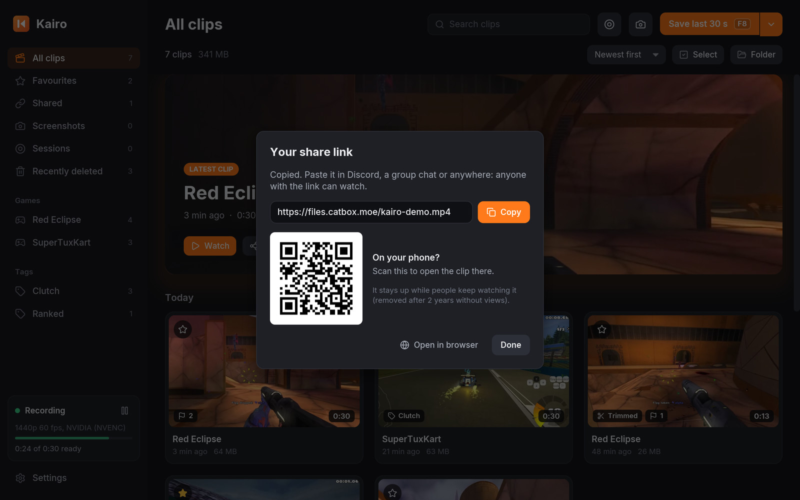
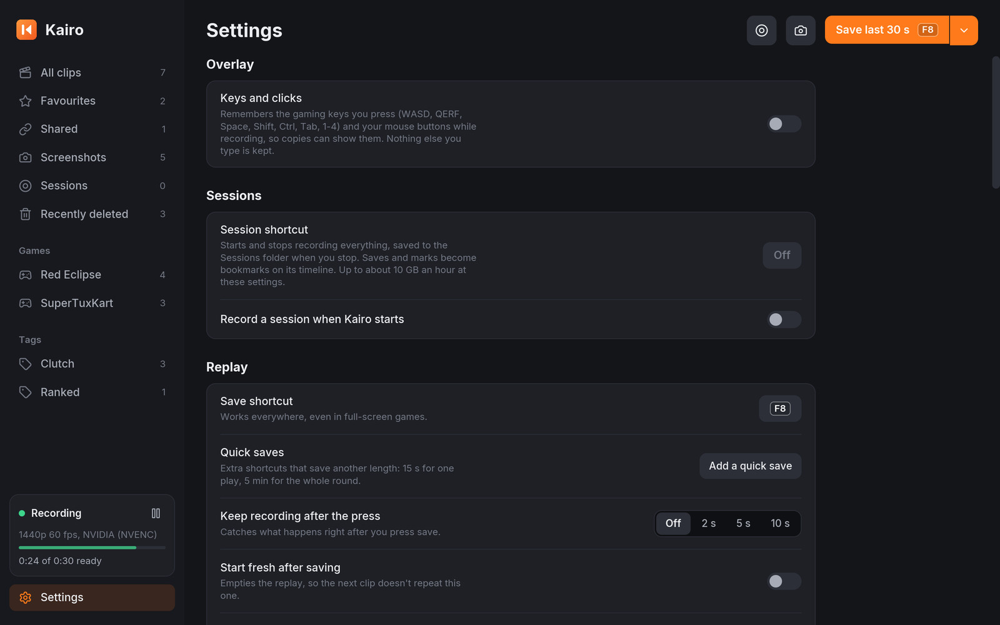
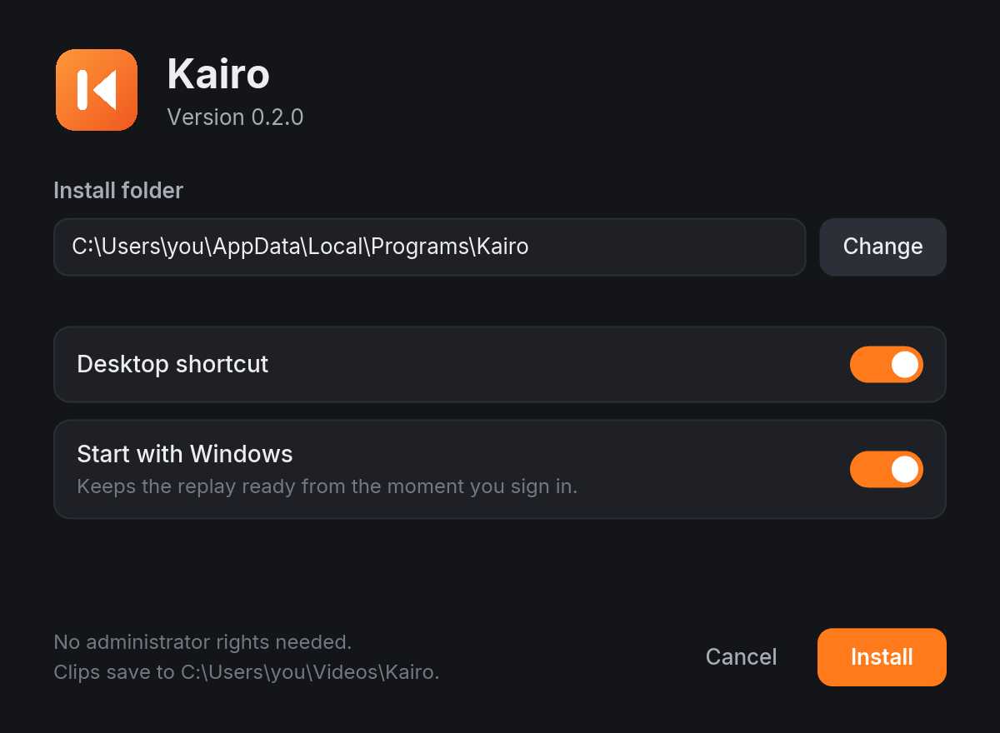

# Kairo

Instant replay for Windows, macOS and Linux. Kairo keeps the last moments of your screen and
sound in memory. Press **F8** and the last 30 seconds are saved as an MP4, like Medal or
ShadowPlay. It's free and open source (MIT), with no account and no ads. Nothing is uploaded
unless you ask for a share link.

**Website and downloads: https://fsiuhgshiqoih32.github.io/kairo/**

<p align="center">
  
</p>
<p align="center"><a href="https://github.com/fsiuhgshiqoih32/kairo/raw/main/docs/media/kairo-demo.mp4">Download the demo in full quality (MP4, 30 s, 7.4 MB)</a><br>
<sub>Gameplay from CC BY 3.0 videos of Red Eclipse and SuperTuxKart (<a href="#license">credits</a>)</sub></p>

- **Always ready, light on games.** The replay is captured and encoded on the GPU (NVIDIA
  NVENC, AMD AMF, Intel and others through Media Foundation, Apple VideoToolbox), with x264 as a
  fallback. It lives in memory, or for long buffers in a scratch file the system caches in spare
  memory, so even minutes of 1440p cost Kairo little.
- **Instant saves.** A clip is cut from the buffer without re-encoding. It's saved in about a
  second and named after the game in front.
- **Editor.** Play a clip with sound, scrub its filmstrip, drag the handles to trim, and save an
  exact trimmed copy. Change its speed and look, add fades and music, balance game, mic and voice
  chat, and make square, 4:5 and 9:16 copies.
- **Captions** of what's said, recognised offline, to edit, keep as .srt or burn in.
- **Share links.** One click uploads a clip and copies a link friends can watch in their browser
  (Discord plays it inline), with a QR code for phones. Links last forever or 1 hour to 3 days.
- **Share for Discord.** One click makes a copy under 10 MB (or 50/500 MB for Nitro) and puts it
  on the clipboard, or posts it straight to a channel you connected with a webhook.
- **Voice clipping.** Say "clip that" and it saves a clip. Speech is recognised offline (Vosk).
- **Markers.** F10 marks a moment while you play; the clip shows a flag there.
- **Longer clips and sessions.** Clips up to 20 minutes, quick-save shortcuts with their own
  lengths, and whole-session recording with bookmarks.
- **H.265** recording on graphics cards that support it, for smaller files.
- **Montages.** Pick clips and join them into one video that dips to black between them.
- **Screenshots** with F9, and **more formats**: GIF, vertical 9:16, slow motion.
- **Gallery.** Filter by game or tag, search, star favourites, rename. Deleted clips wait 30 days
  in Recently deleted, with Undo. Optionally keep the folder under a size limit or drop clips
  older than a week, 30 or 90 days (favourites always stay).
- **Sound.** Desktop audio and your microphone are mixed on the first track, and each is also
  kept on its own track for editing. On Windows 11, voice chat (Discord by default) can go on a
  track of its own.
- **Keys and clicks overlay** (Windows): show the gaming keys and mouse buttons you pressed over
  a clip.

## Screenshots

| The library | The editor |
| --- | --- |
|  |  |
| **A share link** | **Settings** |
|  |  |

## Download

Get the package for your system from the
[latest release](https://github.com/fsiuhgshiqoih32/kairo/releases/latest). ffmpeg is
included, so there is nothing else to install.

- **Windows 10/11 (x64):** run `kairo-…-windows-x64-setup.exe`. It installs Kairo for you
  without administrator rights, adds it to the Start menu, and uninstalls from Settings > Apps.
  The installer isn't code-signed, so Windows may say it protected your PC: choose More info,
  then Run anyway. Or unzip `kairo-…-windows-x64-portable.zip` anywhere and run `kairo.exe`.

  
- **macOS 11+ (Apple silicon and Intel):** unzip `kairo-…-macos-universal.zip` and move
  `Kairo.app` to Applications. It isn't notarized: the first time, right-click it and choose
  Open. Then allow Screen Recording in System Settings > Privacy & Security.
- **Linux (x86_64, X11):** unpack `kairo-…-linux-x86_64-portable.tar.gz` and run `./kairo`.
  Desktop audio needs `parec` (PulseAudio or PipeWire); copying clips needs `xclip` or `wl-copy`.

Kairo checks for updates when its window opens and updates itself in place.

Kairo was called Rewindr until 0.2.0. Rewindr updates itself to Kairo (the `rewindr-…` files in
a release are only for that), and the installer replaces a Rewindr it finds. Settings, clips and
start-up carry over.

## Use

Run Kairo. A tray icon appears and the window opens. Then:

| Key or command | What it does |
| --- | --- |
| **F8** | Save the last 30 seconds (change the key and length in Settings) |
| **F9** | Save a screenshot |
| **F10** | Mark this moment; the clip that holds it shows a flag there |
| Session shortcut | Start or stop recording a whole session (set one in Settings > Sessions) |
| "clip that" | Save a clip by voice (turn it on in Settings > Voice clipping) |
| Click a clip | Open it in the editor: play, trim, share |
| Space, Left/Right, `,` `.`, I/O | In the editor: play, jump a second, step a frame, set start/end |
| M, N / Shift+N | In the editor: mark a moment, go to the next / previous mark |
| Select (library) | Pick clips to join into a montage or delete together |
| Tray > Pause recording | Stop keeping a replay until you resume |
| `kairo save` | Save a clip from a script or desktop shortcut (needed on Wayland) |
| `kairo screenshot` | Save a screenshot the same way |
| `kairo share <clip>` | Upload a clip and print its share link |
| `kairo captions <clip>` | Write captions of what's said (an .srt beside the clip), offline |
| `kairo edit <clip>` | Open a clip in the editor |
| `kairo pause`, `kairo quit` | Pause or resume; stop the background process |
| `kairo devices` | List screens, microphones and the encoders that work |
| `kairo update` | Install the latest version |
| `kairo --self-test` | Check recording and saving on this machine |

Clips go to `Videos/Kairo`. Settings are stored in `config.toml` in your config folder
(`%APPDATA%\kairo` on Windows, `~/Library/Application Support/kairo` on macOS,
`~/.config/kairo` on Linux).

## How it works

ffmpeg captures the screen (Windows Graphics Capture, Desktop Duplication or GDI on Windows,
AVFoundation on macOS, X11 on Linux), encodes it with a keyframe every second, and streams
MPEG-TS stamped with wall-clock time into Kairo. Kairo cuts the stream at keyframes and
keeps the last N seconds in a ring buffer, in memory or (for long buffers) in a fixed-size
scratch file that's deleted when Kairo closes. Sound is captured separately (WASAPI loopback on
Windows, ScreenCaptureKit on macOS, the PulseAudio/PipeWire monitor on Linux, plus the
microphone) and stamped with the
same clock. On save, the video is written from the keyframe just before the cut, the matching
sound beside it, and ffmpeg joins them into an MP4.

## Platform notes

- **Windows:** everything works. Voice chat on its own track needs Windows 11. ARM64 builds
  aren't published yet.
- **macOS:** desktop audio is captured through ScreenCaptureKit on macOS 13 and later (it uses
  the Screen Recording permission); on macOS 11 and 12, only the microphone.
- **Linux:** X11 sessions work. On Wayland, apps can't capture other windows or register global
  shortcuts: run Kairo under XWayland, and bind `kairo save` to a key in your desktop's
  settings. The bundled ffmpeg encodes with NVENC or x264; for VA-API, point `KAIRO_FFMPEG` at
  a system ffmpeg built with it.

## Build

```
cargo build --release
```

Kairo needs an `ffmpeg` next to the program or on `PATH` (or set `KAIRO_FFMPEG`).
`packaging/ffmpeg/build.sh` builds the small one the releases ship.

The Windows installer is its own program in `installer/`, in Kairo's look. It carries a release
zip at the end of its file:

```
cargo build --release -p kairo-setup
target/release/kairo-setup.exe --pack kairo-…-windows-x64-portable.zip kairo-setup.exe
```

`kairo-setup --silent` installs without the window (`--dir`, `--no-desktop`, `--autostart on|off`);
the `uninstall.exe` it leaves takes `--silent` and `--remove-settings`.

The window is built with [iced](https://iced.rs). Its screens can be rendered to PNG files
without opening a window, for checking the UI:
`KAIRO_HOME=<folder with Clips/ and thumbs/> KAIRO_SNAPSHOTS=<out> cargo test -- --ignored gui::preview`.
`kairo --ui-self-test` runs the real window, hidden, on a generated clip: it must show the
first frame and the filmstrip, play, and save a trimmed copy (CI runs it on all three systems).

## License

Kairo is MIT licensed. The bundled ffmpeg is FFmpeg with x264, under the GNU GPL (see
`FFMPEG-LICENSE.txt` and `FFMPEG-SOURCE.txt` in each package). The window uses the Inter
typeface (SIL Open Font License) and Lucide icons (ISC); see `THIRD-PARTY-NOTICES.txt`.
Voice clipping downloads Vosk (Apache 2.0) and its small English model (Apache 2.0) from their
authors when you turn it on.

The gameplay in the demo and screenshots is from
[“Red Eclipse 1.5 Gameplay #1”](https://commons.wikimedia.org/wiki/File:Red_Eclipse_1,5_Gameplay_1.webm)
by Premitre and
[“SuperTuxKart 2.x GP with 24% handicap and road tracks”](https://commons.wikimedia.org/wiki/File:SuperTuxKart_2.x_GP_with_24%25_handicap_and_road_tracks_%28open_source_Mario_Kart-like_Linux_game%29.webm)
by kimden, both [CC BY 3.0](https://creativecommons.org/licenses/by/3.0/) via Wikimedia Commons.
Changes: cut to short excerpts, cropped, resized and re-encoded, placed in screenshots of Kairo,
and captions drawn over the demo. The videos' authors and the games' makers aren't connected
with Kairo and don't endorse it.
